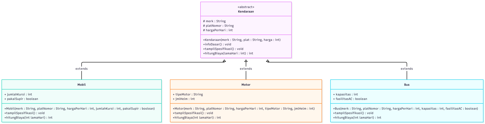

# 🚗 Sistem Rental Kendaraan Sederhana (Tugas Diskusi PBO)

Repositori ini dibuat untuk memenuhi tugas eksplorasi kasus dan diskusi berdua mengenai penerapan konsep **Abstract Class**, **Inheritance (Pewarisan)**, dan **Polymorphism** menggunakan bahasa pemrograman Java.

---

## 👥 Anggota Kelompok (Kelas 3D)

| No | Nama Mahasiswa | NIM |
| :-: | :--- | :--- |
| 1 | Muhammad Bintang Arifin | F1D02510124 |
| 2 | Lalu Hajiril Akbar | F1D02510066 |

---

## 📌 Deskripsi Studi Kasus

Program ini mensimulasikan sistem transaksi di **Rental Kendaraan Maju Jaya** yang menyewakan tiga jenis kendaraan, yaitu **Mobil**, **Motor**, dan **Bus**. 

Meskipun ketiga kendaraan tersebut memiliki data dasar yang sama (merk, plat nomor, dan harga sewa per hari), masing-masing kendaraan memiliki spesifikasi khusus serta aturan perhitungan biaya tambahan dan diskon yang berbeda:

| Jenis Kendaraan | Atribut Khusus | Aturan Perhitungan Biaya Sewa |
| :--- | :--- | :--- |
| **Mobil** | `jumlahKursi`, `pakaiSupir` | Harga dasar dikali hari. Jika memakai supir tambah **Rp100.000/hari**. Jika sewa lebih dari 3 hari dapat diskon **Rp50.000**. |
| **Motor** | `tipeMotor`, `jmlHelm` | Harga dasar dikali hari. Gratis 1 helm pertama, helm tambahan dikenakan biaya **Rp10.000/helm**. |
| **Bus** | `kapasitas`, `fasilitasAC` | Harga dasar dikali hari. Jika menggunakan fasilitas AC tambah biaya perawatan **Rp200.000/hari**. |

---

## 📊 Class Diagram

Berikut adalah rancangan *Class Diagram* dari program yang dibuat:



---

## 💡 Penjelasan Konsep OOP pada Kode

Sesuai instruksi tugas, berikut adalah penjelasan bagian kode yang menerapkan konsep-konsep Pemrograman Berorientasi Objek (PBO):

### 1. Abstract Class & Abstract Method
* **Abstract Class (`Kendaraan`)**: Digunakan sebagai kerangka dasar (*blueprint*) untuk semua jenis kendaraan. Class ini tidak bisa dibuat objeknya secara langsung (`new Kendaraan()` akan menghasilkan *error*), melainkan harus diturunkan ke class anak.
* **Abstract Method (`tampilSpesifikasi` & `hitungBiaya`)**: Dideklarasikan tanpa isi (*body*) di dalam class `Kendaraan` karena cara menampilkan spesifikasi dan rumus menghitung biaya sewa setiap jenis kendaraan berbeda-beda. Setiap class anak wajib melakukan `@Override` terhadap kedua method ini.

```java
abstract class Kendaraan {
    String merk;
    String platNomor;
    int hargaPerHari;

    // Method konkret (memiliki isi dan langsung diwariskan)
    public void infoDasar() { ... }

    // Abstract method (belum memiliki isi, wajib di-override class anak)
    public abstract void tampilSpesifikasi();
    public abstract int hitungBiaya(int lamaHari);
}
```

### 2. Inheritance (Pewarisan)
* Class `Mobil`, `Motor`, dan `Bus` merupakan *subclass* (class anak) yang mewarisi atribut (`merk`, `platNomor`, `hargaPerHari`) dan method `infoDasar()` dari *superclass* (class induk) `Kendaraan` menggunakan kata kunci `extends`.
* Kata kunci `super(merk, platNomor, hargaPerHari)` digunakan di dalam *constructor* masing-masing class anak untuk memanggil *constructor* milik class induknya.

```java
class Mobil extends Kendaraan {
    int jumlahKursi;
    boolean pakaiSupir;

    public Mobil(String merk, String platNomor, int hargaPerHari, int jumlahKursi, boolean pakaiSupir) {
        super(merk, platNomor, hargaPerHari); // Memanggil constructor Kendaraan
        this.jumlahKursi = jumlahKursi;
        this.pakaiSupir = pakaiSupir;
    }
    ...
}
```

### 3. Polymorphism (Polimorfisme)
* Konsep *Polymorphism* diterapkan pada method `main()` dengan mendeklarasikan array bertipe class induk `Kendaraan[]`, namun elemen di dalamnya diisi dengan objek dari berbagai class anak (`Mobil`, `Motor`, dan `Bus`).
* Ketika perulangan `for` memanggil `daftarSewa[i].tampilSpesifikasi()` dan `daftarSewa[i].hitungBiaya()`, Java secara otomatis akan menjalankan isi method sesuai dengan objek aslinya masing-masing (*Method Overriding* / *Dynamic Binding*).

```java
// Array bertipe class induk (Kendaraan), diisi objek class anak (Mobil, Motor, Bus)
Kendaraan[] daftarSewa = new Kendaraan[3];

daftarSewa[0] = new Mobil("Toyota Innova", "DR 1234 AB", 350000, 7, true);
daftarSewa[1] = new Motor("Honda PCX 160", "DR 5678 XY", 90000, "Matic", 2);
daftarSewa[2] = new Bus("Mercedes-Benz OH", "DR 9999 ZZ", 1200000, 40, true);
```

---

## 🔍 Penjelasan Alur Kode (`Main.java`)

1. **Deklarasi `abstract class Kendaraan` (Baris 8–30)**
   * Menyimpan atribut dasar `merk`, `platNomor`, dan `hargaPerHari` yang diisi melalui constructor `Kendaraan(...)`.
   * Memiliki method biasa `infoDasar()` untuk mencetak informasi umum kendaraan.
   * Mendeklarasikan 2 *abstract method*: `tampilSpesifikasi()` dan `hitungBiaya(int lamaHari)` sebagai kontrak yang wajib dibuat isinya oleh class anak.

2. **Deklarasi Class Anak `Mobil`, `Motor`, dan `Bus` (Baris 35–138)**
   * Masing-masing class menggunakan `extends Kendaraan` (Inheritance) dan meneruskan data dasar ke class induk lewat `super(merk, platNomor, hargaPerHari)`.
   * Setiap class anak melakukan `@Override` pada method `tampilSpesifikasi()` untuk mencetak atribut khusus masing-masing.
   * Setiap class anak melakukan `@Override` pada method `hitungBiaya(int lamaHari)` dengan logika percabangan (`if-else`) yang berbeda:
     * `Mobil`: Menambahkan biaya supir Rp100.000/hari dan potongan diskon Rp50.000 jika sewa lebih dari 3 hari.
     * `Motor`: Menambahkan biaya sewa helm ekstra Rp10.000/helm jika menyewa lebih dari 1 helm.
     * `Bus`: Menambahkan biaya fasilitas AC sebesar Rp200.000/hari.

3. **Eksekusi pada `public class Main` (Baris 143–186)**
   * Menerapkan **Polymorphism** dengan membuat array `Kendaraan[] daftarSewa = new Kendaraan[3]` yang diisi oleh objek `new Mobil(...)`, `new Motor(...)`, dan `new Bus(...)`.
   * Menggunakan perulangan `for` untuk menampilkan detail transaksi satu per satu, memanggil `infoDasar()`, `tampilSpesifikasi()`, dan `hitungBiaya()`, lalu menjumlahkan seluruh transaksi ke dalam variabel `totalPendapatanRental`.

---

## 💻 Contoh Output Program

Saat file `Main.java` dijalankan, program akan menghasilkan keluaran sebagai berikut di terminal:

```text
==========================================
     SISTEM RENTAL KENDARAAN MAJU JAYA    
==========================================

--- Data Transaksi ke-1 ---
Nama Penyewa    : Budi Santoso
Lama Sewa       : 4 Hari
Merk Kendaraan  : Toyota Innova
Plat Nomor      : DR 1234 AB
Harga Sewa/Hari : Rp350000
Jenis Kendaraan : Mobil Penumpang
Jumlah Kursi    : 7 Kursi
Layanan Supir   : Ya (+Rp100.000/hari)
Promo           : Diskon sewa > 3 hari (-Rp50.000)
Total Bayar     : Rp1750000
------------------------------------------

--- Data Transaksi ke-2 ---
Nama Penyewa    : Siti Aminah
Lama Sewa       : 2 Hari
Merk Kendaraan  : Honda PCX 160
Plat Nomor      : DR 5678 XY
Harga Sewa/Hari : Rp90000
Jenis Kendaraan : Sepeda Motor (Matic)
Jumlah Helm     : 2 Buah
Biaya Tambahan  : Sewa helm ekstra (+Rp10000)
Total Bayar     : Rp190000
------------------------------------------

--- Data Transaksi ke-3 ---
Nama Penyewa    : Rombongan Kampus
Lama Sewa       : 3 Hari
Merk Kendaraan  : Mercedes-Benz OH
Plat Nomor      : DR 9999 ZZ
Harga Sewa/Hari : Rp1200000
Jenis Kendaraan : Bus Pariwisata
Kapasitas       : 40 Penumpang
Fasilitas AC    : Tersedia (+Rp200.000/hari)
Total Bayar     : Rp4200000
------------------------------------------

Total Seluruh Pendapatan Rental: Rp6140000
```

---

## 🛠️ Cara Menjalankan Program

1. Pastikan **Java Development Kit (JDK)** sudah terpasang di komputer.
2. Unduh atau *clone* repositori ini.
3. Buka terminal atau *Command Prompt* pada folder tempat file `Main.java` berada, lalu jalankan perintah berikut:
   ```bash
   javac Main.java
   java Main
   ```
